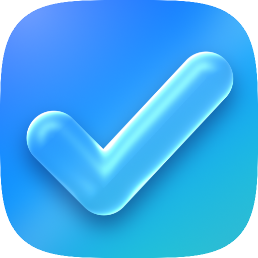

<p align="center">
  
</p>

<h1 align="center">ToDo</h1>

<p align="center">
  A calm daily planner for Android: your to-dos on a dark card, your day as time blocks on a light timeline,
  a focus timer, reminders, and widgets for the home screen and the lock screen.
</p>

<p align="center">
  <a href="#english">English</a> · <a href="#العربية">العربية</a>
</p>

---

## English

### What it does

- **To-dos in projects.** Every project has its own colour and icon. Type into *New To Do* and the quick-add parser
  understands things like `call Sara tomorrow 5pm`, `!!` for priority and project names. A *Nice to do* section keeps
  the "someday" items out of the way, and finished items collect in a *Completed* list.
- **A timeline for the day.** Time blocks with a colour, an icon, a length and an optional alert. Swipe the date bar to
  change day, drag it to give the timeline more or less room, long-press an empty slot to add a block.
- **Drag and drop.** Hold a to-do and drop it on a block, on an empty part of the timeline (a new block is created)
  or on the bin to delete it.
- **Focus mode.** Tap a block to start a countdown with its to-dos next to it. The countdown also lives in a
  notification (with a live chronometer and a *Stop* action). On Android 16 it is a *Live Update*: a countdown chip in
  the status bar and a progress bar in the block's colour. On OnePlus phones it can sit in the *Live Alerts* capsule
  around the camera: switch ToDo on under *Settings › Notifications & Quick Settings › Live Alerts*.
- **The island.** While a focus session runs and the app is not in front, it shows as an island around the camera,
  like in Anchor: a black pill with a progress ring and the countdown that springs open into a card (title, minutes
  left, and the dial of your day with the running block glowing and the neighbouring blocks dimmed). Tap the pill to
  open it, tap the card to come back to the app, swipe up to close it. See *The island* below for how to switch it on.
- **Notifications.** To-do reminders (with *Done* and *Snooze*), a heads-up a few minutes before every block, a daily
  summary, and a note when a focus session ends. An optional ongoing notification shows what is next.
- **Widgets.** *Tasks* (tick items off straight from the widget), *Timeline* and *Next up*. They are declared for the
  home screen **and** the lock screen (`home_screen|keyguard`); whether your phone offers lock-screen widgets depends
  on its Android version and manufacturer.
- **Shortcuts.** A *New To Do* launcher shortcut and a Quick Settings tile.
- **Private by design.** Everything is stored in one JSON file on the phone. No account, no ads, no tracking, no network
  permission. Export or restore a backup from Settings.

### Install

Open the latest build on the **Releases** page of this repository, download `ToDo-release.apk` on your phone and open
it (Android asks once to allow installs from your browser or file manager).
`ToDo-debug.apk` is the same app without optimisation and is only meant for troubleshooting.

Every push to `main` is built by GitHub Actions (`.github/workflows/android.yml`) and published as a new release.
If a build ever fails, the workflow posts the compiler errors as a comment on the commit.
All builds are signed with the same key and get a higher version number each time, so a newer APK installs over the
older one and keeps your data.

### The island

Open **Settings › Island** in the app.

1. Switch *Focus island* on and allow **Display over other apps**. If that switch is greyed out (Android locks it for an
   APK that did not come from a store), open *App info › ⋮ › Allow restricted settings* first and try again. The island
   now shows over your apps while a focus session runs and ToDo is not in front. Android draws the status bar *above*
   such windows, so taps on the camera area itself go to the status bar: the closed island reaches a little below the bar
   and that lower edge takes the tap, and the opened card hangs under the status bar so that its icons do not cover it. A
   camera hole near the middle of the screen is wrapped by the island; on a phone without one (or with the hole in a
   corner) the island sits at the top centre.
2. *Preview* shows the island without a running session.

**Island size (Settings › Island size).** The status bar paints its own icons (alarm, headphones, Wi-Fi, signal...) over
the island, and an app cannot look at them without an accessibility service or notification access, which Google Play
Protect blocks (see below). So the island goes by what the phone reports to any app, and gets smaller when something
that would be a status bar icon next to the camera is on:

| Size | What it looks like |
|---|---|
| *Wide* | the ring left of the camera, the time right of it (the Anchor picture) |
| *Left* | the ring and the time both left of the camera, the right half pulled in |
| *Small* | the ring alone |
| *Auto* (default) | *Wide* when nothing is reported, *Left* as soon as there is an alarm, connected headphones, Wi-Fi, a VPN, Do Not Disturb or silent mode |

It changes with a short slide (getting smaller at once, getting wider after about eight seconds of calm, so that an icon
that comes and goes does not make it pump). Settings says what Auto sees right now. The guess is only a guess: it cannot
know the notification icons on the left, or how wide your phone's status bar icons are. If it is wrong, pick a size
yourself. (Above the status bar, in the debug build's accessibility window, nothing is in the way and the island is
always wide. Right-to-left status bars, where the icons sit on the other side, are not handled.)

While the island is on, the focus notification is a normal ongoing notification (no Live Update chip), so the system
capsule and the island do not fight over the same spot. Switch the island off to get the Live Update back.

**Why there is no accessibility service in the release APK.** An accessibility service may draw above the status bar and
on the lock screen, and the debug build still has one as an optional second host of the island (*Settings › Accessibility
› ToDo island*; it declares no content access and cannot read the screen). But Google Play Protect refuses to install an
app that declares an accessibility service (or a notification listener, or SMS permissions) when the APK comes from a
browser or a file manager in some countries: the phone shows *"App blocked to protect your device"* and offers no way
around it. The release APK therefore leaves the service out, and the build job fails if it ever comes back in
(`src/debug/AndroidManifest.xml` is the only place that declares it).

**How far this has been tested.** In CI the island runs on Android 14 and Android 16 emulators (debug and release builds,
with emulated camera holes of three sizes): the pop-in, the spring opening, the turning dial with its glow, the closing,
taps on the closed island and on the card, and the *Preview* row; the debug build also runs through the accessibility
window above the status bar, including the lock screen. It has **not** been run on a real phone with a real camera hole,
so spacing against the real status bar and the manufacturer's battery rules may still differ. (The emulator froze within
minutes in the accessibility window when it used its `swiftshader_indirect` graphics and never with `swangle_indirect`,
so the CI uses the latter for that part.)

### Build it yourself

Requirements: JDK 17 and the Android SDK (platform 36).

```bash
./gradlew :app:assembleDebug      # app/build/outputs/apk/debug/app-debug.apk
./gradlew :app:assembleRelease    # app/build/outputs/apk/release/app-release.apk
```

Both builds are signed with the fixed key in `keystore/todo.keystore` (committed on purpose, password `android`) so that
every build installs over the previous one. It is only meant for sideloading this personal app: use your own private
keystore before publishing anywhere else.

### How it is built

Kotlin, Jetpack Compose (without Material components — every control is custom drawn), Jetpack Glance for the
widgets, `AlarmManager` for reminders. The data model, the JSON codec, the quick-add parser and the timeline layout
are plain Kotlin without Android dependencies.

```
app/src/main/java/com/shdurazi/todo
├── core/      data model, JSON, quick-add parser, timeline layout, queries, planner, repository
├── notify/    channels, notifications, alarm scheduling, receivers, Quick Settings tile
├── island/    the focus island: hand-drawn view, window controller, accessibility host (declared in debug builds only)
├── widget/    Tasks / Timeline / Next up widgets (Glance)
└── ui/        theme, components, home, sheets, focus, settings
```

### Credits

Typeface: [Inter](https://rsms.me/inter/) (SIL Open Font License, see `licenses/`).

---

## العربية

### ما هو التطبيق؟

مخطط يومي هادئ لأندرويد: مهامك على بطاقة داكنة، ويومك كفترات زمنية على جدول فاتح، مع مؤقّت تركيز وتذكيرات وودجت
للشاشة الرئيسية وشاشة القفل.

- **مهام داخل مشاريع** لكل مشروع لون وأيقونة. الإضافة السريعة تفهم عبارات مثل `اتصل بسارة tomorrow 5pm` وعلامة `!!`
  للأولوية وأسماء المشاريع، وقسم «Nice to do» للمهام غير العاجلة وقائمة «Completed» للمنجَز.
- **جدول زمني لليوم** بفترات ملوّنة بأيقونة ومدة وتنبيه اختياري. اسحب شريط التاريخ لتغيير اليوم أو لتكبير الجدول
  وتصغيره، واضغط مطوّلاً على مكان فارغ لإضافة فترة.
- **السحب والإفلات:** أمسك مهمة وأفلتها على فترة، أو على مكان فارغ (تُنشأ فترة جديدة)، أو على سلة الحذف.
- **وضع التركيز:** اضغط على فترة لبدء العدّ التنازلي، ويظهر أيضاً في إشعار مع زر إيقاف. على أندرويد 16 يصير «Live Update»
  (عدّاد في شريط الحالة وشريط تقدّم بلون الفترة)، وعلى أجهزة OnePlus يظهر في كبسولة Live Alerts حول الكاميرا بعد تفعيل
  ToDo من: الإعدادات ← Notifications & Quick Settings ← Live Alerts.
- **الجزيرة (Island):** أثناء جلسة التركيز، وعندما لا يكون التطبيق مفتوحاً، تظهر الجلسة كجزيرة حول الكاميرا مثل Anchor:
  كبسولة سوداء فيها حلقة تقدّم والعدّ التنازلي، تنفتح بحركة نابضة إلى بطاقة فيها اسم الفترة والدقائق المتبقية وقرص اليوم
  (الفترة الجارية متوهّجة والفترات المجاورة خافتة). اضغط على الكبسولة لفتحها، وعلى البطاقة للعودة للتطبيق، واسحب للأعلى
  لإغلاقها. طريقة التفعيل في قسم «الجزيرة» أدناه.
- **الإشعارات:** تذكير بالمهام (تم / تأجيل)، تنبيه قبل كل فترة، ملخص يومي، وإشعار عند انتهاء التركيز، مع إشعار دائم اختياري
  بما هو قادم.
- **الودجت:** المهام (علّم المهمة منجزة من الودجت نفسه)، الجدول الزمني، و«التالي». معرَّفة للشاشة الرئيسية ولشاشة القفل؛
  وتوفّر ودجت القفل يعتمد على إصدار أندرويد وشركة الجهاز.
- **اختصارات:** اختصار «New To Do» على أيقونة التطبيق وبلاطة في الإعدادات السريعة.
- **خصوصية كاملة:** كل البيانات في ملف واحد على الهاتف، بلا حساب ولا إعلانات ولا تتبّع ولا صلاحية إنترنت. نسخ احتياطي
  واستعادة من الإعدادات.

### التثبيت

افتح صفحة **Releases** في هذا المستودع، نزّل الملف `ToDo-release.apk` على هاتفك وافتحه (سيطلب أندرويد السماح بالتثبيت من
المتصفح أو مدير الملفات مرة واحدة). الملف `ToDo-debug.apk` للتجربة وحل المشاكل فقط.

كل تحديث على الفرع `main` يُبنى تلقائياً عبر GitHub Actions ويُنشر كإصدار جديد. كل النسخ موقّعة بنفس المفتاح، فالنسخة
الأحدث تُثبَّت فوق القديمة وتحتفظ ببياناتك.

### الجزيرة

من التطبيق: **Settings ‹ Island**.

1. فعّل *Focus island* واسمح بـ **Display over other apps**. إذا كان المفتاح باهتاً (أندرويد يقفله للتطبيقات التي لم تأتِ من
   متجر) افتح *معلومات التطبيق ← ⋮ ← السماح بالإعدادات المقيّدة* ثم ارجع وجرّب. بعدها تظهر الجزيرة فوق التطبيقات أثناء جلسة
   التركيز عندما لا يكون ToDo مفتوحاً. أندرويد يرسم شريط الحالة *فوق* هذا النوع من النوافذ، لذلك الضغط على منطقة الكاميرا
   نفسها يذهب لشريط الحالة: الجزيرة المغلقة تنزل قليلاً تحت الشريط وهذه الحافة السفلية هي التي تستقبل الضغط، والبطاقة
   المفتوحة تتدلى تحت شريط الحالة حتى لا تغطيها أيقوناته. إذا كانت فتحة الكاميرا قرب منتصف الشاشة تلتف الجزيرة حولها، وإلا
   (لا توجد فتحة أو هي في الزاوية) تظهر في أعلى المنتصف.
2. زر *Preview* يعرض الجزيرة بدون جلسة تركيز.

**حجم الجزيرة (Settings ‹ Island size).** شريط الحالة يرسم أيقوناته (المنبّه، السماعات، الواي فاي، الشبكة...) فوق الجزيرة،
ولا يستطيع التطبيق رؤيتها بدون خدمة إمكانية وصول أو وصول للإشعارات، وهذان يحجبهما Google Play Protect (انظر أدناه). لذلك
تعتمد الجزيرة على ما يخبر به الهاتف أي تطبيق، وتصغر عندما يكون شيء مما يظهر كأيقونة في شريط الحالة قرب الكاميرا شغّالاً:

| الحجم | شكله |
|---|---|
| *Wide* | الحلقة يسار الكاميرا والوقت يمينها (شكل Anchor) |
| *Left* | الحلقة والوقت كلاهما يسار الكاميرا، والنصف الأيمن ينكمش |
| *Small* | الحلقة فقط |
| *Auto* (الافتراضي) | *Wide* إذا لم يُبلَّغ بشيء، و*Left* بمجرد وجود منبّه أو سماعات متصلة أو واي فاي أو VPN أو عدم الإزعاج أو الوضع الصامت |

يتغير الحجم بانزلاق قصير (يصغر فوراً، ويكبر بعد نحو ثماني ثوانٍ من الهدوء حتى لا «تنبض» الجزيرة إذا كانت أيقونة تظهر وتختفي).
والإعدادات تقول ما الذي يراه Auto الآن. وهو مجرد تقدير: لا يعرف أيقونات الإشعارات على اليسار ولا عرض أيقونات شريط الحالة
في هاتفك. إذا أخطأ فاختر الحجم بنفسك. (فوق شريط الحالة، في نافذة إمكانية الوصول لنسخة debug، لا شيء في الطريق فتبقى
الجزيرة واسعة دائماً. وشريط الحالة من اليمين لليسار، حيث تكون الأيقونات في الجهة الأخرى، غير مدعوم.)

وأثناء تفعيل الجزيرة يصير إشعار التركيز إشعاراً دائماً عادياً (بدون شريحة Live Update) حتى لا تتعارض الكبسولة النظامية
مع الجزيرة. أوقف الجزيرة لترجع Live Update.

**لماذا لا توجد خدمة إمكانية وصول في نسخة release.** خدمة إمكانية الوصول تستطيع الرسم فوق شريط الحالة وعلى شاشة القفل،
ولا تزال نسخة debug تحتوي واحدة كمضيف ثانٍ اختياري للجزيرة (*Settings ‹ Accessibility ‹ ToDo island*؛ لا تطلب الوصول
لمحتوى الشاشة ولا تقرأها). لكن Google Play Protect يرفض تثبيت أي تطبيق يعلن عن خدمة إمكانية وصول (أو مستمع إشعارات أو
صلاحيات SMS) إذا جاء ملف APK من متصفح أو مدير ملفات في بعض الدول: يظهر على الهاتف *"App blocked to protect your device"*
بلا أي خيار للتجاوز. لذلك تخلو نسخة release من الخدمة، ويفشل بناء GitHub Actions إذا عادت إليها
(الملف `src/debug/AndroidManifest.xml` هو المكان الوحيد الذي يعلن عنها).

**ما الذي اختُبر.** تُشغَّل الجزيرة في CI على محاكيات أندرويد 14 و16 (نسخة debug ونسخة release، مع فتحات كاميرا مُحاكاة
بثلاثة أحجام): الظهور، الفتح النابضي، القرص الدائر مع التوهج، الإغلاق، الضغط على الجزيرة المغلقة وعلى البطاقة، وصف
*Preview*؛ وتختبر نسخة debug أيضاً النافذة فوق شريط الحالة وعلى شاشة القفل عبر خدمة إمكانية الوصول. **لم** تُجرَّب بعد
على هاتف حقيقي بفتحة كاميرا حقيقية، فقد تختلف المسافات مع شريط الحالة الحقيقي وقيود البطارية عند الشركة المصنّعة.
(المحاكي كان يتجمّد خلال دقائق في نافذة إمكانية الوصول عندما يستخدم رسم `swiftshader_indirect` ولم يتجمّد أبداً مع
`swangle_indirect`، لذلك يستخدم CI الثاني لهذا الجزء.)
